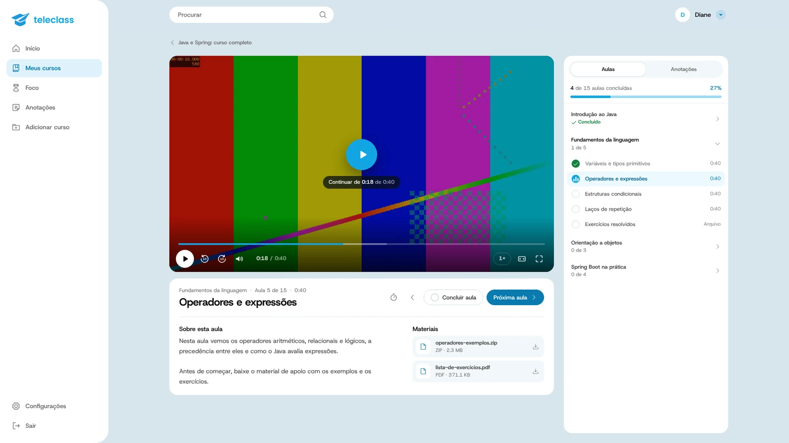
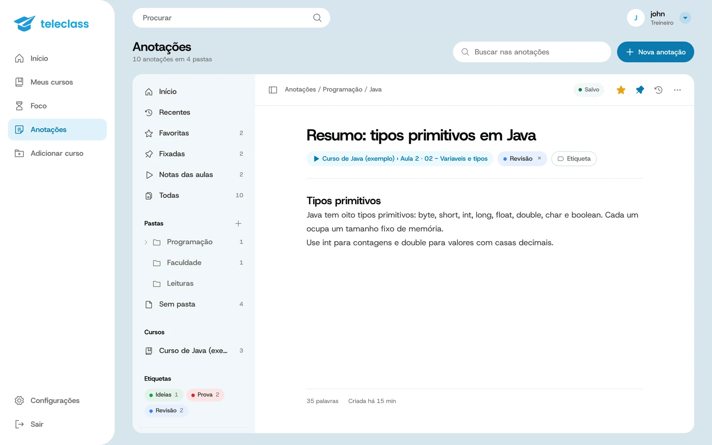
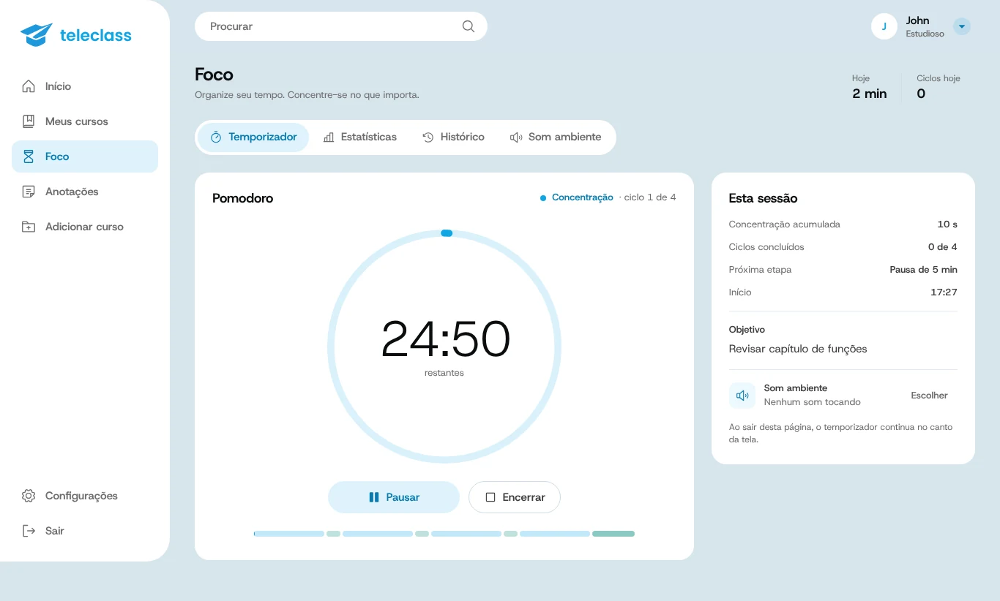

  

<h1 align="center">TeleClass</h1>

  Os cursos dos canais do Telegram, organizados como uma área de membros.

  <a href="https://teleclass.duckdns.org"><strong>Acessar teleclass.duckdns.org&nbsp;→</strong></a>

 

  

 

Muitos professores publicam cursos inteiros em canais do Telegram, mas o
Telegram não foi feito para estudar: não mostra o que você já assistiu, não
retoma o vídeo de onde parou e não separa nada em módulos. O TeleClass lê o
canal, monta o curso com módulos e aulas e deixa você assistir tudo num só
lugar, com o seu progresso salvo.

## Como começar

1. Abra **[teleclass.duckdns.org](https://teleclass.duckdns.org)** e crie uma conta.
2. Conecte o seu Telegram. O jeito mais rápido é **Entrar com QR code**:
   no celular, abra o Telegram em *Configurações › Dispositivos › Conectar
   dispositivo* e aponte para a tela.
3. Em **Adicionar curso**, cole o link de um canal do qual você já participa.
   O curso aparece em *Meus cursos*.

Funciona no navegador do computador e do celular. Não precisa instalar nada.

## O que dá para fazer

**Assistir como num curso de verdade.** Módulos, aulas, materiais para baixar,
"continuar de onde parei" e próxima aula automática. O player tem atalhos de
teclado, velocidade e modo cinema.

**Acompanhar o progresso.** Cada aula fica marcada como concluída, em
andamento ou pendente. A tela inicial mostra sua sequência de dias, o tempo
estudado na semana e os cursos recentes.

**Anotar enquanto assiste.** Notas com marca de tempo clicável direto na aula
e um caderno completo com pastas, etiquetas, busca, tabelas, fórmulas,
imagens e histórico de versões.

**Estudar com foco.** Temporizador com Pomodoro, 52/17, Deep Work ou o seu
próprio método, sons ambientes, metas, níveis e conquistas.

<table>
  <tr>
    <td width="50%"></td>
    <td width="50%"></td>
  </tr>
  <tr>
    <td align="center">Anotações</td>
    <td align="center">Foco</td>
  </tr>
</table>

## Privacidade

- O TeleClass usa a sua conta do Telegram **só para ler** os canais em que
  você já está. Ele não envia mensagens, não entra em canais e não apaga nada.
- Os vídeos tocam direto do Telegram. Nada é republicado nem fica disponível
  para outras pessoas.
- Sua biblioteca, seu progresso e suas anotações são só seus.
- Você pode desconectar o Telegram a qualquer momento pelo menu da conta, ou
  encerrar a sessão pelo próprio Telegram em *Configurações › Dispositivos*.

## Perguntas frequentes

**O código de login do Telegram não chegou.**
Use **Entrar com QR code** na mesma tela. Às vezes o Telegram não envia o
código para servidores, e o QR code resolve na hora.

**Posso adicionar qualquer canal?**
Qualquer canal do qual a sua conta já participa, público ou privado.

**Os vídeos ficam salvos em algum lugar?**
Não. Eles são transmitidos do Telegram enquanto você assiste.

## Sobre o código

O TeleClass é feito com FastAPI e Telethon no backend e React com Vite no
frontend. O código está aberto para leitura; a forma recomendada de usar é
pelo site. Notas de arquitetura ficam em [`docs/`](docs).
